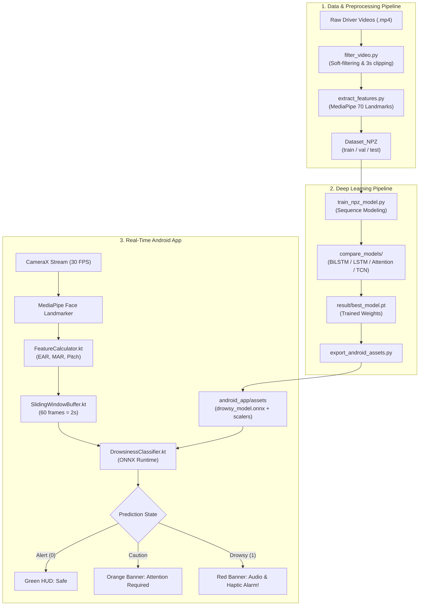
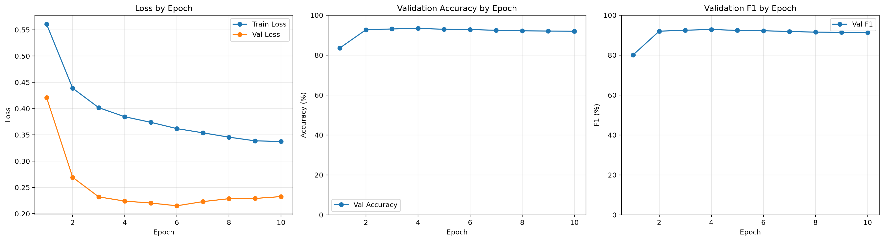
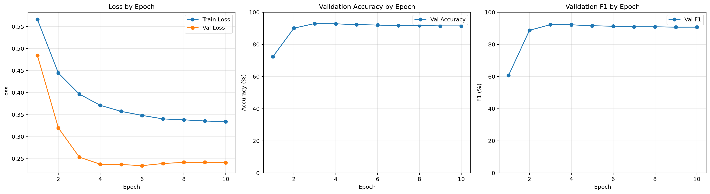

# Driver Drowsiness Detection System (AI-Powered Mobile & Deep Learning)

<p align="center">
  
  
  
  
  
  
  
  
</p>

An end-to-end, edge-deployable **Driver Drowsiness and Fatigue Detection System** combining computer vision, sequence deep learning, and a native Android application for real-time driver safety monitoring.

---

## Highlights

- **Edge-First Design:** Entire inference pipeline runs 100% on-device (offline) without server latency or privacy concerns.
- **Ultra-Lightweight Model:** BiLSTM model has a footprint of only **~64 KB (PyTorch)** and **~28 KB (ONNX)**, with inference latency **< 10ms** per sliding window.
- **Robust Feature Engineering:** Extracts 7 physiological and geometric features from 70 curated MediaPipe facial landmarks, including:
  - **EAR (Eye Aspect Ratio):** Micro-sleeps and prolonged eye closures.
  - **MAR (Mouth Aspect Ratio):** Yawning frequency and duration.
  - **Head Pitch Proxy:** Head nodding and forward dropping.
  - **Brow & Iris Dynamics:** Fatigue frowns and gaze distraction.
- **Comprehensive Benchmarks:** Rigorous comparative study evaluating 6 sequence architectures (BiLSTM, LSTM, LSTM + Attention, TCN, GNN-TCN, and NPZ Baseline) on over 40,000 real-world video frames.
- **Production-Ready Android App:** Native Kotlin app featuring **CameraX (30 FPS)**, **Picture-in-Picture (PiP)** mode, personalized baseline calibration, and dual audio-haptic alarm mechanisms.

---

## System Architecture



---

## 📊 Model Benchmark Results

Evaluated on test sets with 60-frame sequence windows (2 seconds at 30 FPS):

| Model Architecture | Best Epoch | Val Acc (%) | Val F1 (%) | Test Acc (%) | Test F1 (%) | Test Loss | Key Advantage |
| :--- | :---: | :---: | :---: | :---: | :---: | :---: | :--- |
| **LSTM + Attention (Handcrafted)** | 6 | 92.01% | 91.29% | **91.70%** | **91.21%** | 0.2301 | Highest test generalization & attention weights |
| **BiLSTM (Android Deployed)** | 6 | **92.81%** | **92.21%** | **90.30%** | **89.52%** | 0.2542 | Optimal trade-off: 28 KB ONNX, sub-10ms latency |
| **BiLSTM Baseline (NPZ)** | 8 | 92.26% | 91.61% | 90.26% | 89.54% | 0.2510 | Robust landmark representation |
| **Vanilla LSTM (Handcrafted)** | 5 | 93.21% | 92.78% | 89.90% | 89.10% | 0.2679 | Fast sequential recurrent state |
| **TCN (Temporal ConvNet)** | 7 | 89.13% | 87.24% | 88.49% | 86.94% | 0.2943 | Parallel convolutional receptive field |
| **GNN-TCN (Graph + TCN)** | 5 | 88.97% | 87.12% | 87.11% | 85.05% | 0.3187 | Spatial graph topological modeling |

<p align="center">
  
  
</p>

---

## Repository Structure

```
.
├── .github/
│   └── workflows/
│       └── ci.yml               # GitHub Actions Continuous Integration workflow
├── android_app/                 # Native Android Application (Kotlin)
│   ├── app/
│   │   ├── src/main/
│   │   │   ├── java/com/example/myapplication/
│   │   │   │   ├── detection/   # FeatureCalculator, Classifier, Buffer, Smoother
│   │   │   │   ├── MainActivity.kt
│   │   │   │   └── AlertManager.kt
│   │   │   ├── assets/          # ONNX model, scalers, MediaPipe task asset
│   │   │   └── res/             # UI layouts, icons, strings, themes
│   │   └── build.gradle.kts
│   ├── gradle/
│   ├── build.gradle.kts
│   ├── settings.gradle.kts
│   └── README.md                # Android setup and build instructions
├── compare_models/              # Model comparison suite & experimental benchmarks
│   ├── outputs_bilstm_handcrafted_seq60/
│   ├── outputs_lstm_attention_handcrafted_seq60/
│   ├── outputs_lstm_handcrafted_seq60/
│   ├── outputs_tcn_handcrafted_seq60/
│   ├── outputs_gnn_tcn_handcrafted_seq60/
│   ├── outputs_npz_handcrafted_seq60/
│   ├── benchmark_summary.py     # Automated benchmark Markdown generator
│   └── README.md                # Comparative benchmark report
├── data_processing/             # Dataset preprocessing and feature extraction
│   ├── filter_video.py          # Video quality filter & rule-based clip slicing
│   ├── extract_features.py      # MediaPipe 70-landmark extraction to NPZ
│   ├── face_landmarker.task     # MediaPipe Face Landmarker model
│   └── README.md                # Preprocessing pipeline guide
├── training_model/              # PyTorch model training & ONNX export
│   ├── dataset.py               # Dataset loader, augmentations & EAR/MAR math
│   ├── train_npz_model.py       # Sequence model training script
│   ├── predict_npz.py           # Evaluation & inference script
│   ├── export_android_assets.py # Export PyTorch -> ONNX & scaler sync
│   ├── requirements.txt         # Training dependencies
│   ├── result/                  # Best trained checkpoint (BiLSTM)
│   └── README.md                # Model training documentation
├── docs/                        # Benchmark graphs & project assets
├── .editorconfig                # Code styling configuration
├── .gitignore                   # Comprehensive Git ignore rules
├── LICENSE                      # MIT Open Source License
├── README.md                    # Root project documentation
└── requirements.txt             # Unified Python dependencies
```

---

## Quick Start Guide

### 1. Environment Setup

Clone the repository and set up a Python virtual environment:

```bash
git clone https://github.com/tuanhm2112/driver-drowsiness-detection.git
cd driver-drowsiness-detection

python -m venv venv
# On Windows:
.\venv\Scripts\activate
# On Linux/macOS:
source venv/bin/activate

pip install -r requirements.txt
```

---

### 2. Data Preprocessing

Process raw driver video clips into structured landmark sequences:

```bash
cd data_processing

# Step 1: Filter raw video and slice into candidate clips
python filter_video.py --input-video "path/to/raw_video.mp4" --output-dir "path/to/clips"

# Step 2: Extract 70 facial landmarks into NPZ archives
python extract_features.py
```

---

### 3. Model Training & Export

Train the sequence classifier and export it for mobile deployment:

```bash
cd ../training_model

# Train the BiLSTM sequence model
python train_npz_model.py \
  --data-root "path/to/Dataset_NPZ" \
  --output-dir "result" \
  --sequence-length 60 \
  --batch-size 32 \
  --epochs 30 \
  --handcrafted-only

# Export trained weights to ONNX and sync assets to the Android app
python export_android_assets.py \
  --model-dir "result" \
  --android-assets-dir "../android_app/app/src/main/assets"
```

---

### 4. Running the Android Application

1. Open **Android Studio** (Hedgehog, Iguana, or Ladybug recommended).
2. Select **Open** and choose the `android_app/` folder.
3. Connect an Android phone (running Android 7.0+ / API 24+) with **USB Debugging enabled**.
4. Click **Run** (`Shift + F10`) or build the APK via command line:
   ```bash
   cd android_app
   ./gradlew.bat assembleDebug   # Windows
   ./gradlew assembleDebug       # Linux/macOS
   ```
5. Install and launch the app:
   - Grant Camera permission.
   - Follow the 2-step onboarding calibration.
   - Mount phone in driver's line of sight and start monitoring.

---

## Author

**Hoang Minh Tuan**
- GitHub: [@tuanhm2112](https://github.com/tuanhm2112)
- Email: tuanhm211224@gmail.com

---

## 📄 License

This project is licensed under the [MIT License](LICENSE).
